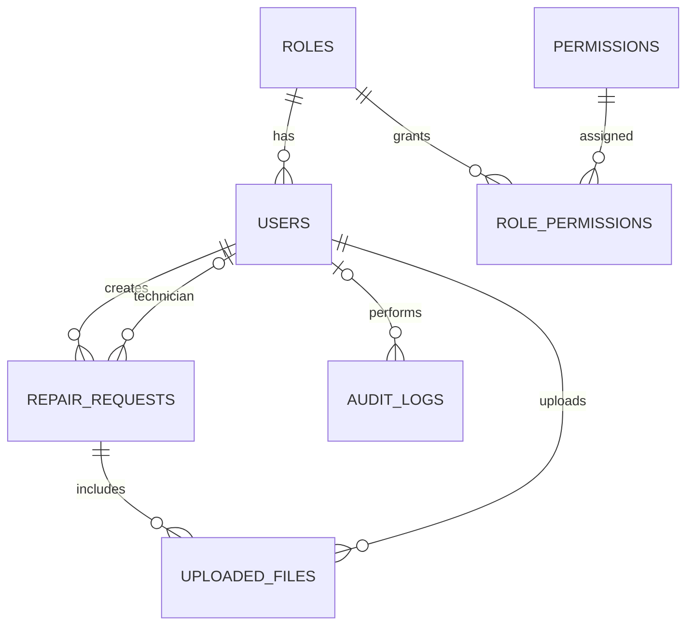

# FixFlow — ระบบแจ้งซ่อมและติดตามงาน

เว็บแอปพลิเคชันสำหรับโครงงาน Node.js + Express.js + PostgreSQL มี 4 บทบาท, Authentication ด้วย bcrypt, Session เก็บใน PostgreSQL, ACL แบบ Role × Permission, Audit Log, กระบวนการแจ้งซ่อม/พิจารณา/มอบหมาย/อัปเดตงาน และไฟล์แนบที่ตรวจชนิดและขนาดฝั่ง Server

## 1. สิ่งที่ต้องติดตั้ง
- Windows 10/11
- Node.js 20 ขึ้นไป
- PostgreSQL 15 ขึ้นไป และ pgAdmin (ถ้าต้องการใช้ GUI)

## 2. เตรียมฐานข้อมูล (ทำครั้งแรกเท่านั้น)
ค่าเริ่มต้นใน `.env` ตั้งไว้ `postgres` / `123456` ตามที่กำหนดไว้สำหรับชุดนี้ หากรหัสผ่าน PostgreSQL ในเครื่องไม่ตรง ให้เปลี่ยน `DATABASE_URL` ใน `.env` ให้ตรงกับเครื่องก่อนเริ่มระบบ (PostgreSQL ไม่อนุญาตให้เว็บเปลี่ยนรหัสผู้ดูแลฐานข้อมูลให้เอง)

เปิด PowerShell ในโฟลเดอร์โปรเจกต์ แล้วสร้างฐานข้อมูล:
```powershell
& "C:\Program Files\PostgreSQL\18\bin\psql.exe" -U postgres -h localhost -p 5432 -d postgres -c "CREATE DATABASE fixflow_db;"
```
หาก PostgreSQL รุ่นอื่น ให้เปลี่ยนเลขโฟลเดอร์ `18` ให้ตรงกับรุ่นที่ติดตั้ง ถ้าฐานข้อมูลมีอยู่แล้ว ข้ามคำสั่ง CREATE DATABASE

สร้างตาราง (ใช้ไฟล์ SQL):
```powershell
Get-Content .\db\schema.sql -Raw | & "C:\Program Files\PostgreSQL\18\bin\psql.exe" -U postgres -h localhost -d fixflow_db
```
กรอก password ของ PostgreSQL เมื่อระบบถาม (ค่าเริ่มต้นที่ใส่ใน .env คือ `123456`)

## 3. ติดตั้งและเริ่มใช้งาน
เปิด PowerShell ในโฟลเดอร์โปรเจกต์:
```powershell
npm.cmd install
npm.cmd run seed
npm.cmd start
```
เปิด `http://localhost:3000` ใน Chrome หากใช้ PowerShell ที่บล็อก `npm.ps1` ให้ใช้ `npm.cmd` ตามตัวอย่าง

## 4. บัญชีทดสอบ
| บทบาท | Username | Password |
|---|---|---|
| Admin | `admin` | `Admin@12345` |
| ผู้จัดการ | `manager` | `Manager@12345` |
| ช่างซ่อม | `tech` | `Tech@12345` |
| ผู้แจ้งซ่อม | `requester` | `User@12345` |

เรียก `npm.cmd run seed` ซ้ำได้เพื่อรีเซ็ตรหัสบัญชีตัวอย่างข้างต้นให้กลับเป็นค่าที่ระบุ (ไม่ลบคำขอแจ้งซ่อม)

## 5. ทดสอบสาธิตตามลำดับ
1. เข้าระบบ `requester` → **แจ้งซ่อมใหม่** → กรอกหัวข้อ/รายละเอียด/สถานที่ → ส่งคำขอ
2. ออกจากระบบ แล้วเข้า `manager` → เปิดรายการ → เปิดคำขอ → อนุมัติ → มอบหมายให้ `ช่างซ่อมตัวอย่าง`
3. ออกจากระบบ แล้วเข้า `tech` → เปิดงานที่มอบหมาย → เปลี่ยนสถานะเป็น `รอตรวจรับ` และ `เสร็จสิ้น`
4. เข้า `admin` → **ผู้ใช้** เพื่อดู/เพิ่มบัญชีและเปลี่ยน Role; **บทบาท** เพื่อเพิ่ม Role; **ACL** เพื่อกำหนด Permission; **Audit Log** เพื่อค้นหาตามผู้ใช้ เหตุการณ์ และวันที่
5. อัปโหลด JPG/PNG/PDF ขนาดไม่เกิน 5 MB ในรายละเอียดคำขอ แล้วเปิดไฟล์แนบ; ทดลองไฟล์ชนิดไม่รองรับหรือไฟล์ใหญ่กว่า 5 MB เพื่อดูการปฏิเสธ
6. ทดสอบการป้องกัน: ออกจากระบบแล้วเปิด `/app`; เข้าด้วย `requester` แล้วพิมพ์ `/admin/users` ควรถูกปฏิเสธ; ผู้แจ้งซ่อมลองเปิดคำขอของบัญชีอื่นต้องถูกปฏิเสธ

## 6. Endpoint ตรวจระบบ
เปิด `http://localhost:3000/health` ควรเห็น JSON ที่มี `status: ok` และชื่อฐานข้อมูล `fixflow_db`.

## 7. โครงสร้างและสิ่งที่ใช้
- `server.js` — Express routes, Middleware, Authentication/Authorization, upload และ error handling
- `db/schema.sql` — ตารางและข้อจำกัดฐานข้อมูล
- `scripts/seed.js` — บัญชีสาธิตและ Permission ตั้งต้น
- `views/` — หน้าเว็บ EJS
- `public/style.css` — รูปแบบหน้าเว็บ
- `uploads/` — ไฟล์จริงที่อัปโหลด (metadata อยู่ใน PostgreSQL)
- Session อยู่ในตาราง `user_sessions` ซึ่ง `connect-pg-simple` สร้างให้อัตโนมัติ

## 8. Access Matrix (สรุปค่าเริ่มต้น)
| ฟังก์ชัน | Admin | ผู้จัดการ | ช่างซ่อม | ผู้แจ้งซ่อม |
|---|---|---|---|---|
| Dashboard | ทั้งหมด | ดู | ดู | ดู |
| ดูคำขอ | ทั้งหมด | ทั้งหมด | งานที่รับผิดชอบ/ของตน | ของตน |
| สร้างคำขอ | ✓ | — | — | ✓ |
| อนุมัติ/ปฏิเสธ | ✓ | ✓ | — | — |
| มอบหมายช่าง | ✓ | ✓ | — | — |
| อัปเดตงานซ่อม | ✓ | — | งานที่ได้รับมอบหมาย | — |
| ไฟล์แนบ | ทุกไฟล์ | ทุกไฟล์ | งานที่เกี่ยวข้อง | รายการของตน |
| จัดการผู้ใช้/Role/ACL | ✓ | — | — | — |
| ดู Audit Log | ✓ | — | — | — |

ACL ในหน้าเว็บเป็นค่าที่เก็บใน PostgreSQL และตรวจซ้ำที่ Server ทุก Route ที่ป้องกันไว้ โดยมีเงื่อนไขเจ้าของรายการ/ผู้รับผิดชอบเพิ่มอีกชั้นหนึ่ง

## 9. ER Diagram (Mermaid)


## 10. หมายเหตุสำคัญ
- รหัสผ่านผู้ใช้เก็บเป็น bcrypt hash พร้อม salt; ไม่บันทึกรหัสผ่านลง Log
- ไม่เผยไฟล์อัปโหลดผ่าน URL สาธารณะ การดาวน์โหลดผ่าน Route ที่ตรวจ Session, Permission และความเกี่ยวข้องกับรายการ
- อนุญาต JPG/JPEG, PNG, WEBP, PDF, TXT; จำกัด 5 MB ที่ Server
- การเพิ่ม Permission ผ่าน UI จำกัดเฉพาะรหัสที่ระบบมี Route/API รองรับ ไม่รับรหัสอิสระที่ไม่มีการบังคับใช้
- โปรเจกต์นี้เป็นชุดสาธิตการเรียนรู้ ควรเปลี่ยน `SESSION_SECRET` และข้อมูลรับรองฐานข้อมูลก่อนใช้งานจริงบนอินเทอร์เน็ต
